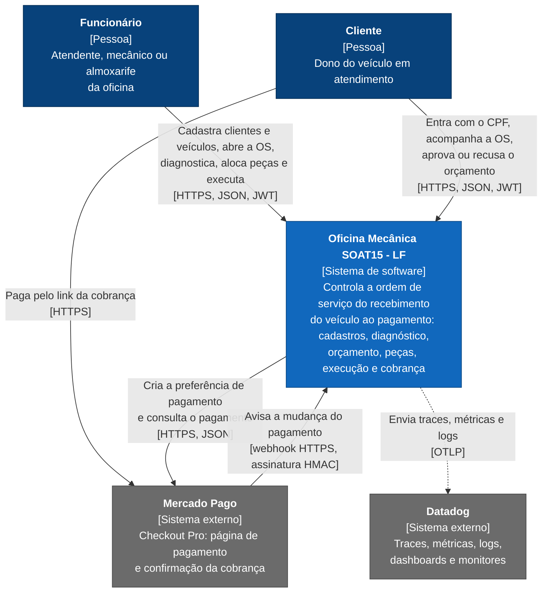
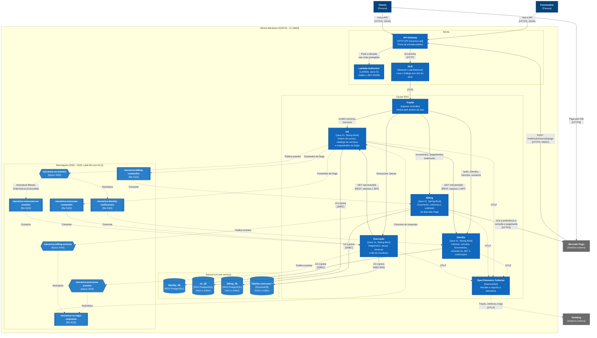

# Diagramas C4 da Fase 4

Visão da Oficina Mecânica SOAT15 - LF no [modelo C4](https://c4model.com/), do mais geral para o mais detalhado. Os diagramas são Mermaid e o GitHub os desenha na própria página.

| Nível | O que mostra | Onde está |
|---|---|---|
| 1. Contexto | Quem usa o sistema e com quais sistemas externos ele conversa | [abaixo](#nível-1-contexto) |
| 2. Contêineres | Os serviços, bancos, filas e a borda, e como se comunicam | [abaixo](#nível-2-contêineres) |
| 3. Componentes | A estrutura interna de cada serviço | README de cada repositório (links [abaixo](#nível-3-componentes)) |

A visão de implantação na AWS (VPC, sub-redes, EKS e contas) está no [diagrama da AWS](arquitetura-aws-fase4.png).

Legenda de cores: azul-escuro para pessoas, azul para o que faz parte do sistema, cinza para sistemas externos. Linha cheia é chamada síncrona; linha tracejada é mensagem assíncrona ou telemetria.

## Nível 1: Contexto

O cliente consulta a situação pela placa sem se autenticar; as demais rotas exigem o token emitido pelo Identity ([`jwt.md`](../../contratos/jwt.md)). A notificação de mudança de situação ao cliente hoje é só um registro em log ([ADR-F4-12](../adr/ADR-F4-12-notificacoes-no-identity.md)), por isso não há sistema de e-mail no diagrama.

## Nível 2: Contêineres

Como ler:

- **Borda:** o API Gateway chama o authorizer nas rotas protegidas e encaminha ao NLB; as rotas públicas (logins, consulta por placa, webhook, health e Swagger) passam direto. Cada serviço valida o JWT de novo. Decisão na [ADR-F4-06](../adr/ADR-F4-06-borda-api-gateway-authorizer-nlb.md); rotas e perfis em [`rotas.md`](../../contratos/rotas.md).
- **Saga orquestrada:** o OS envia comandos para a fila de cada participante e recebe as respostas pela fila `mecanica-os-saga-respostas`, que assina os tópicos do Execução e do Billing ([ADR-F4-02](../adr/ADR-F4-02-saga-orquestrada.md), [ADR-F4-03](../adr/ADR-F4-03-sns-sqs-sdk-v2.md)). A lista de mensagens está em [`convencoes.md`](../../contratos/convencoes.md).
- **Outbox e idempotência:** nenhum serviço publica direto na transação de negócio. A mensagem é gravada no outbox do próprio banco e publicada depois; o consumidor descarta repetições ([ADR-F4-04](../adr/ADR-F4-04-outbox-consumidor-idempotente.md)).
- **Um banco por serviço:** nenhum serviço lê o banco de outro ([ADR-F4-05](../adr/ADR-F4-05-database-per-service.md)). O modelo do DynamoDB está na [RFC-F4-02](../rfc/RFC-F4-02-modelagem-dynamodb-execucao.md).
- **Chamadas síncronas entre serviços:** só duas, com timeout, retry e repasse do token de quem chamou ([ADR-F4-09](../adr/ADR-F4-09-rest-sincrono-resilience4j.md)).
- **Observabilidade:** o agente OpenTelemetry de cada serviço envia ao collector, que exporta para o Datadog ([ADR-F4-10](../adr/ADR-F4-10-observabilidade.md)).

Ficaram fora do diagrama, para não poluir: o Secrets Manager (credenciais dos bancos, chave privada do JWT e segredos do Mercado Pago), o SSM (parâmetros trocados entre os repositórios, [ADR-F4-14](../adr/ADR-F4-14-ssm-entre-repositorios.md)), o ECR e as DLQs.

## Nível 3: Componentes

Os serviços seguem a mesma arquitetura hexagonal (`domain`, `application`, `adapters`, `config`), descrita em [`convencoes.md`](../../contratos/convencoes.md). O detalhe interno fica no README de cada repositório, junto do código:

- [Identity](https://github.com/fiap-postech-soat-lf/fiap-soat-mecanica-identity#readme), [Billing](https://github.com/fiap-postech-soat-lf/fiap-soat-mecanica-billing#readme) e [Execução](https://github.com/fiap-postech-soat-lf/fiap-soat-mecanica-execucao#readme): com diagrama de componentes.
- [OS](https://github.com/fiap-postech-soat-lf/fiap-soat-mecanica-os#readme) e [Lambda Authorizer](https://github.com/fiap-postech-soat-lf/fiap-soat-mecanica-auth#readme): estrutura e fluxo descritos em texto e tabelas.
